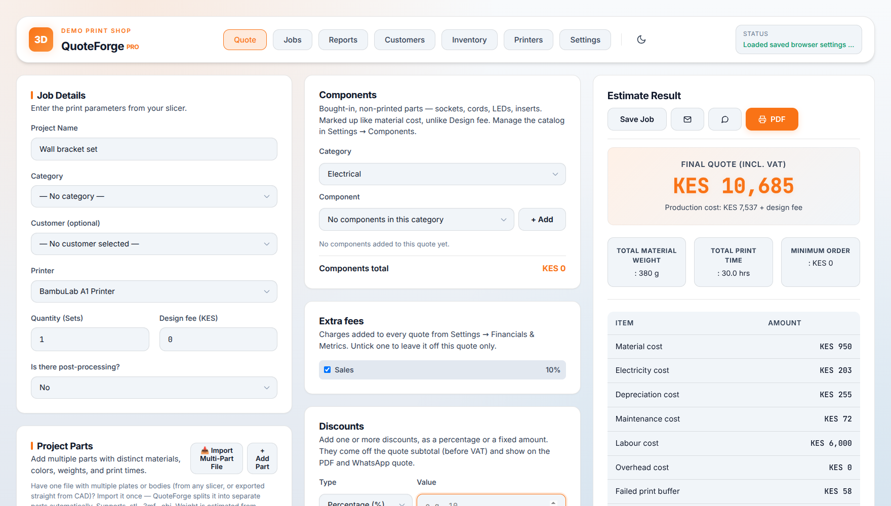
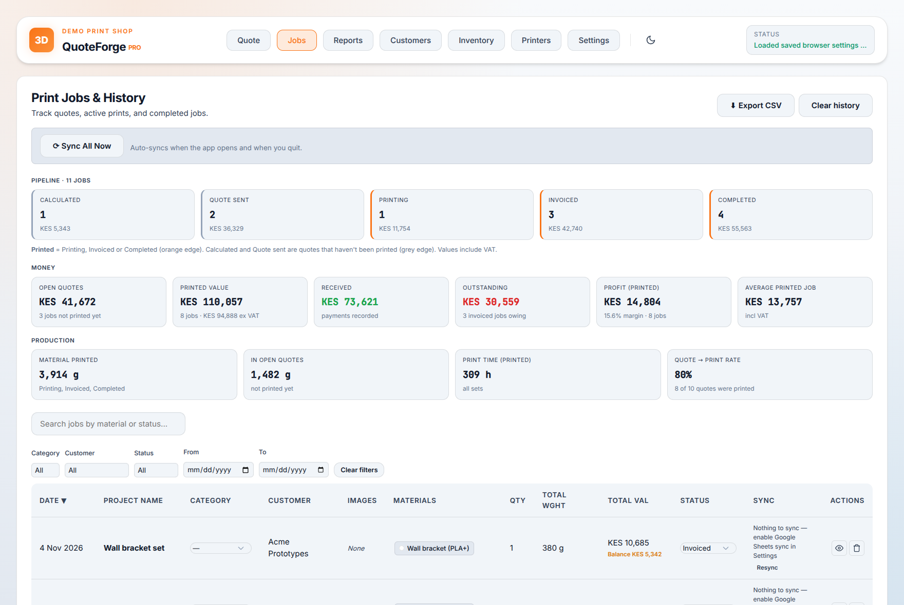
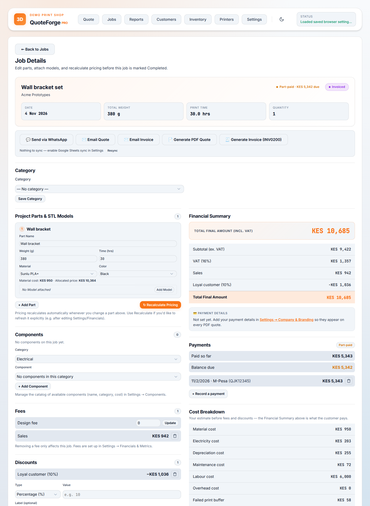
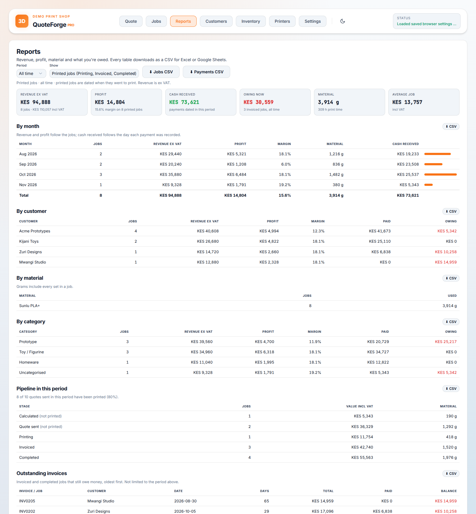

# QuoteForge Pro

An open source, self-hostable quote calculator for 3D printing businesses.
Configure your own currency, materials, printers, pricing rules, and payment
methods — nothing is preloaded or locked to one business, region, or
currency.

**Bambu Lab printers get real live status** (state, progress, temperatures)
over their local MQTT connection. That's the only feature that needs an extra
package (`mqtt`), and it's an *optional* dependency: the app has no required
dependencies, so if you don't own a Bambu printer you can skip `npm install`
entirely and just run `node server.js`.

## Screenshots

| Quote — inputs, fees, discounts and a live result | Jobs — what you've quoted vs what you've printed |
|---|---|
|  |  |

| A job — fees and discounts, then the summary and payments | Reports — revenue, profit, cash and what's owing |
|---|---|
|  |  |

(Demo data. The layout uses the whole window and adapts down to a phone.)

Ways to run it — pick whichever fits:

## Option 1 — Native Desktop App (macOS & Windows)

Best for: solo operators and workshop computers who want a true native desktop application with a dock/taskbar icon, standard OS menus, and window controls.

- **To run in development:**
  ```bash
  npm install
  npm run electron
  ```
- **To build standalone installers:**
  ```bash
  npm run dist:mac   # Generates .dmg installer for macOS (Apple Silicon + Intel) in dist/
  npm run dist:win   # Generates .exe (NSIS installer) for Windows 64-bit in dist/
  ```
- Built with Electron: embeds the local Node.js backend automatically, so end users don't need to install Node or open any terminals.
- All application data continues to save directly to `~/.quoteforge/` on the local machine.
- Automated release builds for `.dmg` and `.exe` are configured in `.github/workflows/desktop-build.yml`.

## Option 2 — Chrome / Edge Web App (PWA)

Best for: Chrome or Chromium-based browser users who want an installed desktop experience without heavy installer packages.

1. Start the app via `npm start`, `.command`/`.bat`, or visit your self-hosted instance in Google Chrome or Microsoft Edge.
2. Click the **Install QuoteForge Pro** icon in the browser address bar (or Menu → Save and Share → Install QuoteForge Pro).
3. The app opens in its own borderless window, gets a desktop/dock shortcut, and caches the app shell locally via Service Worker for instant loading.

## Option 3 — Portable Script Launchers (Run Locally)

Best for: running directly from source on a laptop or USB drive without building full desktop binaries. It launches a local server and opens your default browser.

**Requirements:** [Node.js](https://nodejs.org) v18 or newer.

- **Mac / Linux:** double-click `Start-QuoteForge-Pro.command`
  (first time on Mac: right-click → Open, then click Open again — this is
  normal for any unsigned script downloaded from the internet)
- **Windows:** double-click `Start-QuoteForge-Pro.bat`
- **Any OS, via terminal:** `npm install --omit=dev` once, then `npm start`
  (or `node server.js`)

The launcher scripts run `npm install` automatically the first time. To skip the optional Bambu Lab
package, use `npm install --omit=optional` or just run `node server.js`
without installing anything.

Your data is saved to a `.quoteforge` folder in your home directory, so it
survives even if you move or update the app folder.

By default the app only listens on your own machine (`127.0.0.1`), so other
devices on your Wi-Fi can't see it.

## Option 4 — Self-host (Docker)

Best for: a small team or shop that wants everyone hitting the same shared
data from a server, a home NAS, a Raspberry Pi, or a cloud host (Railway,
Render, Fly.io, a VPS, etc.).

**Requirements:** [Docker](https://docs.docker.com/get-docker/) installed.

```bash
docker compose up -d
```

Then open `http://localhost:8080` (or your server's address, if hosting
remotely). Data is stored in a Docker volume (`quoteforge-data`) so it
survives restarts and image rebuilds.

To change the port:

```bash
# edit docker-compose.yml, or override at the command line:
PORT=9090 docker compose up -d
```

To stop it: `docker compose down` (your data volume is untouched).

The container runs as the unprivileged `node` user. The default named volume
just works; if you switch to a bind mount (`./data:/data`), make that folder
writable by user ID 1000 (`sudo chown 1000:1000 ./data`).

To update after pulling new code: `docker compose up -d --build`.

**Deploying somewhere with a fixed public URL?** The container reads `PORT`
and `DATA_DIR` from the environment, so it works out of the box with most
Node-friendly hosts — just point them at the `Dockerfile` and mount a
persistent volume at `/data`.

**Heads up if hosting remotely:** there's no login/authentication built in —
anyone with the URL can view and edit the data. Put it behind your own
auth (a reverse proxy with basic auth, a VPN, Tailscale, etc.) if it's not
staying on a private network. See [Security](#security).

## First run

The first time you open QuoteForge (either option), a short setup screen
walks you through picking a currency, business name, and tax rate — it
pre-fills a currency guess from your browser's locale, but you can change
it to anything. Everything else (materials, printers, product categories,
payment methods) starts empty; add your own from Settings.

## What this includes

- `index.html` / `calculator.js` / `styles.css` — the app itself.
- `server.js` — the local server (also what runs inside the Docker image).
- `config.json` — default settings on first run (safe to edit or delete).
- `Dockerfile` / `docker-compose.yml` — self-hosting.
- `Start-QuoteForge-Pro.command` / `Start-QuoteForge-Pro.bat` — portable launchers.
- `google-apps-script/Code.gs` — optional Google Sheets integration for
  syncing quotes to a product catalogue sheet (see the script's own
  comments for setup).
- `extras/` — an example Windows installer script (NSIS), not part of the
  supported release; see `extras/README.md`.

## Currency & payment methods

Any ISO currency code works — set it once in setup, change it any time in
Settings → Company Details. Payment methods (Bank Transfer, PayPal, Stripe,
Wise, Mobile Money, Crypto, Cash, or a custom "Other") are all available
regardless of currency; the "add payment method" list just reorders itself
to put whatever's common in your region first.

## Network printer discovery

Settings → Add Printer → **Scan Network** finds printers on your LAN and fills
in the Add Printer form for you:

- **Bambu Lab** (P1, X1, A1, H2 and others): found automatically from the
  printer's own network announcement, with its serial number and whether LAN
  Only Mode is on. You only type the 8-digit access code shown on the printer.
  Turn on **LAN Only Mode** (and **Developer Mode** on newer models) under
  Settings → WLAN on the printer. A **Test connection** button checks the
  details before you save. Needs the optional `mqtt` package (installed by a
  normal `npm install`).
- **Prusa** (PrusaLink: MK4, MK3.9, MK3.5, MINI, XL, CORE One; MK2.5/MK3S via a
  Raspberry Pi), **OctoPrint**, and **Klipper/Moonraker** (Voron, Creality K1,
  Snapmaker U1, QIDI and any Klipper machine, on ports 7125, 80 or 4408).
- **Elegoo** newer models that use the SDCP protocol (for example Centauri
  Carbon), and **Duet / RepRapFirmware** boards.

Printers on a different network, such as a separate printer Wi-Fi or VLAN, can
be scanned by typing that network (for example `192.168.5.0/24`) in the box next
to the Scan button. Only private address ranges are accepted.

Status is read-only: the app shows state, progress and temperatures; it doesn't
start or stop prints. See `docs/PRINTER-SUPPORT.md` for the full list of what is
supported, how each one connects, and what has been verified.

**Not supported:** stock (non-Klipper) Anycubic and Creality/Ender firmware don't
offer a local connection.

If you're self-hosting via Docker, discovery needs the container to
actually see your LAN. The default Docker bridge network won't allow
this — set `network_mode: host` in `docker-compose.yml` (see the comment
there) if you want this feature to work in a container.

## What customers see

The WhatsApp message, PDF quote and invoice are all built from one place, so
they always agree. They show the items, subtotal, each discount, total before
VAT, VAT and the total — every line is a whole-number amount that adds up from
the lines above it, so a customer with a calculator gets the same answer.
They deliberately do **not** show print time, weights, cost breakdowns, your
margin or the names of your internal fees (those are folded into the item
prices).

**Tax:** Settings → Financials & Metrics → *Tax Name* sets what your tax is
called on every quote, invoice and report (VAT, GST, Sales Tax, IVA, MwSt...).
*Tax Applies To* chooses how it is worked out. *Print price only* is how
QuoteForge has always behaved (fees and design work aren't taxed);
*Everything (after discounts)* charges tax on the whole quote, and the
documents then show the rate, e.g. "GST (10%)", because that is exactly what
the number is. One flat rate is supported; per-region sales tax and
tax-inclusive pricing are not built yet. Ask your accountant which applies to
you. Add your tax ID in Settings → Company & Branding and it's printed on
every quote and invoice.

**Deposits and payments:** set *Deposit to start work (%)* in Company &
Branding and every quote gets "Deposit to start" and "Balance on completion"
lines. Then record what customers actually pay in the job's **Payments**
section (amount, method — bank transfer, card, cash, PayPal, mobile money — date
and a note such as a transaction ID). Payments work at any stage, even after a
job is Completed. The Jobs list shows *Paid ✓*, *Balance …* (in your
currency) or *Unpaid* (once invoiced), and
the invoice lists each payment received and the balance still due.

**Works offline:** the fonts (Inter, JetBrains Mono — SIL Open Font License,
licences in `vendor/fonts`) are bundled, so the app makes no requests to Google
or anyone else.

## Jobs stats, reports and CSV

**Jobs tab stats.** The panel at the top separates what you've *quoted* from
what you've actually *printed*: a pipeline of Calculated → Quote sent →
Printing → Invoiced → Completed (click a stage to filter the list), then money
(open quotes, printed value, received, outstanding, profit, average job,
below-target margin) and production (material printed vs sitting in open
quotes, print hours, and your quote → print rate). **Printed** means Printing,
Invoiced or Completed. The stats follow the filters below them, so you can ask
"what did we print for Storytime in October?". Material and hours count every
set of a job.

**Reports tab.** Pick a period (this month, last month, last 90 days, this
year, last year, all time or custom) and show printed jobs only or everything
including quotes. You get revenue (ex VAT), profit and margin, cash received,
what's owing now, then tables by month (with a bar), customer, material and
category, the pipeline for the period, and the outstanding invoices. Printed
jobs are dated from when they went to print. Cash is dated by the day each
payment was recorded.

**CSV export.** Every table has a ⬇ CSV button, the Reports tab can export the
jobs and the payments for the chosen period, and the Jobs tab has an
*Export CSV* button for the list as filtered. Files are UTF-8 with a byte-order
mark so Excel and Google Sheets read them correctly, headers contain no
currency symbol, and any text starting with `=`, `+`, `-` or `@` is prefixed
with an apostrophe so a customer or project name can't run as a spreadsheet
formula.

## Rounding, margin warning and email

- **Round Quote Total** (Settings → Financials & Metrics): round the final
  total to 5, 10, 50, 100 or 500, to the nearest or always up. The difference
  shows as its own *Rounding* line on the quote, invoice and WhatsApp message,
  so the customer's sums still add up. Each job remembers the rule it was
  priced with.
- **Warn Below Margin** (same place): a warning appears on the Quote tab, the
  result and the saved job when a quote's margin drops under your figure —
  typically after discounts. Margin is measured on the ex-VAT price, the same
  basis as your Profit Margin setting. 0 turns it off.
- **Email**: ✉️ buttons on the Quote tab and in each job open your mail app
  with the quote (or invoice) written out and the customer's address filled in.
  A mail link can't attach files, so use the PDF button and attach it yourself.
  Emailing a draft marks it *Quote sent*, like WhatsApp does.

## Self-hosting notes

- **One person at a time.** All data lives in one file and every save writes the
  whole thing, so if two people (or two browser windows) edit at once, the last
  save wins and can overwrite the other's newer changes. QuoteForge is built for
  one shop with one person using it at a time. If a second person needs to look,
  have them open it only to read, or reload before editing.
- **HTTPS.** The optional password uses HTTP Basic auth, which isn't encrypted
  on plain HTTP. Put a reverse proxy with HTTPS in front when it leaves your
  network. For example with [Caddy](https://caddyserver.com) (automatic
  certificates):
  ```
  quotes.example.com {
    reverse_proxy quoteforge:8080
  }
  ```
- **Health check.** `GET /healthz` answers `{"status":"ok"}` with no password
  and no data, for Docker, reverse proxies and uptime monitors.
- **Your data and backups.** In Docker everything is in the `/data` volume.
  Back that volume up (or use Settings → Export Backup) — the automatic backups
  in `backups/` sit on the same disk.
- **Upgrading.** Replace the app files (or pull the new image) and keep your data
  volume / `~/.quoteforge` folder. Newer versions read data saved by older ones.

## Security

QuoteForge is built for a trusted, private setup, not the open internet.

- **Optional password.** By default there is no login: anyone who can reach
  the server can read and change all data, including customer details and
  printer credentials. To require one, set `QUOTEFORGE_PASSWORD` (and
  optionally `QUOTEFORGE_USER`, default `quoteforge`) — the browser then asks
  for a username and password. Docker: uncomment `environment:` in
  `docker-compose.yml`. It uses HTTP Basic auth, which sends the password
  unencrypted over plain HTTP, so if it leaves a trusted network put HTTPS in
  front (reverse proxy) or use a VPN / Tailscale.
- **Local by default.** Run directly (`npm start` / the launchers), it listens
  on `127.0.0.1` only, and rejects requests from other websites in your
  browser. The Docker image listens on all interfaces (`HOST=0.0.0.0`) so it
  can be reached — keep it on a private network, set a password, or put your
  own authentication in front of it.
- **Only app files are served.** The web server hands out the front-end files
  and nothing else; source, tests and package files in the install folder are
  not downloadable.
- **Plain-text storage.** Jobs, settings, printer access codes/API keys and
  your Google Sheets webhook URL are stored unencrypted in `app-data.json`
  (in `~/.quoteforge`, or the Docker volume). Don't share that file or a
  backup export; anyone holding the webhook URL can write to your sheet.

## Data & backups

Everything is stored in one file, `app-data.json` (in `~/.quoteforge`, or the
Docker volume at `/data`). Saves are crash-safe: each one is written to a
temporary file and swapped in, so a power cut or crash can't leave a half-written
file. QuoteForge also keeps:

- `app-data.json.bak` — the version before the latest save;
- `backups/app-data-YYYY-MM-DD.json` — the state at the start of each day you
  used it (last 7 days).

If the data file is ever unreadable, it is moved aside as
`app-data.corrupt-<time>.json` and the newest valid backup is restored
automatically.

These live on the same disk, so they protect against crashes and mistakes, not
a dead drive. Use Settings → Export Backup to download a full JSON snapshot of
your jobs, materials, printers, and settings and keep it somewhere else — and
Import Backup to restore it (or move it to another machine/deployment).

## Development & tests

```bash
npm install
npm test
```

`npm test` needs no browser or running server. It loads the real app in a
simulated browser (jsdom) and drives the quote form, discounts, extra fees and
saved-job editing, payments, the Jobs stats and Reports tab, CSV downloads,
checks that customer documents hide your costs and that their totals can be
reproduced from the lines shown, unit-tests the pricing and reporting maths, and starts the real server to
check the localhost guards, saving, backups, corrupt-file recovery and running
without the optional `mqtt` package. GitHub Actions runs it on Linux, macOS and
Windows with Node 18, 20 and 22, and also builds the Docker image.

## License

GNU AGPL v3 — see `LICENSE`. Designed and built by Ovid International Ltd.

In short: you can use, self-host and modify QuoteForge Pro for free. If you
distribute it, or let other people use a modified version over a network (for
example as a hosted service), you must make your complete source code available
to those users under the same license. If that doesn't suit you, a commercial
license is available from Ovid International Ltd. Bundled third-party
components keep their own licenses; see `THIRD-PARTY-NOTICES.md`.
